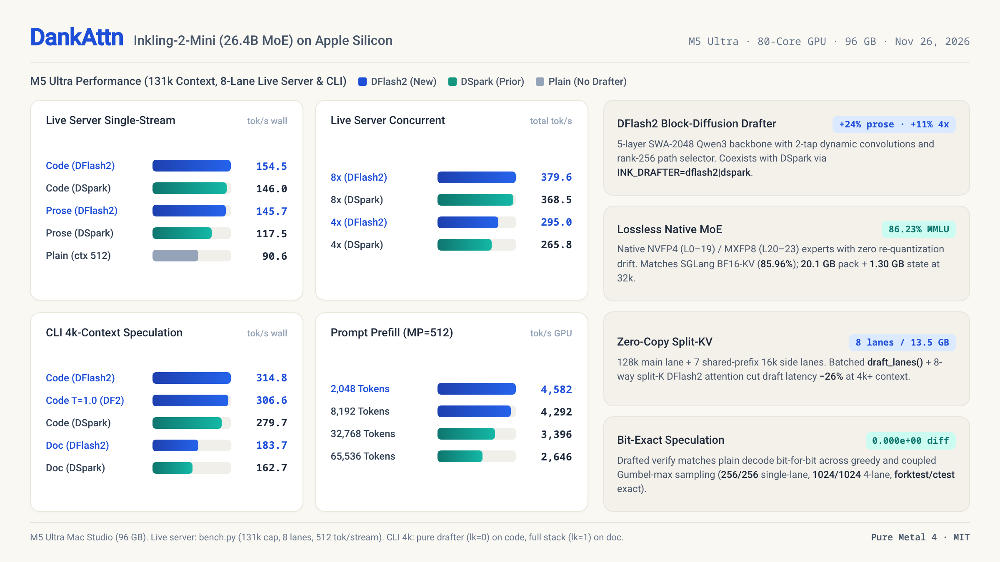
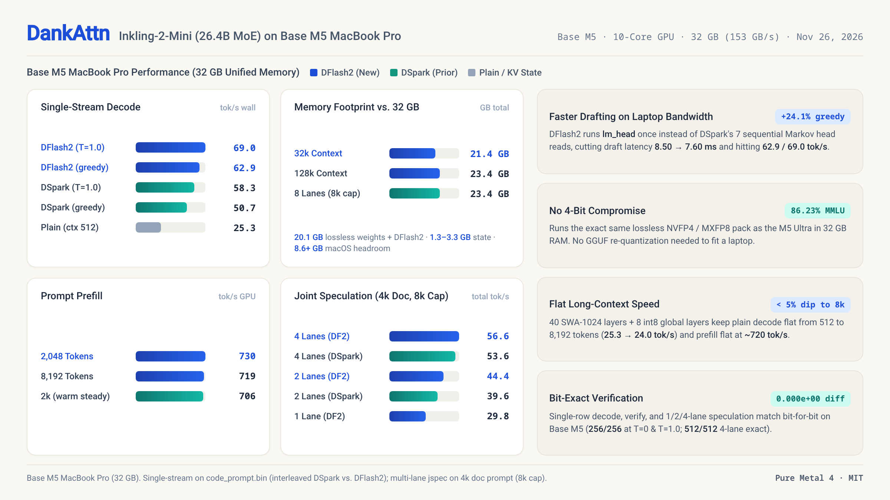
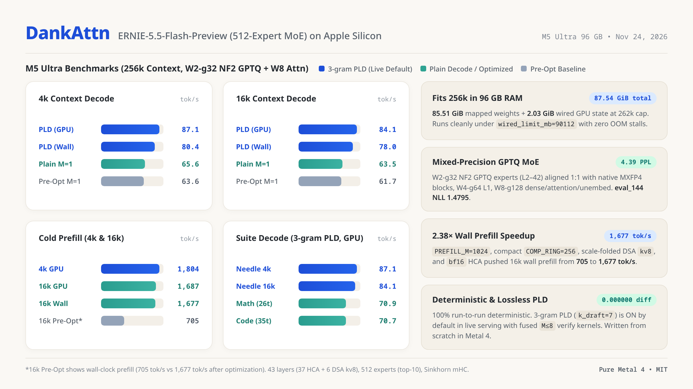

# DankAttn


DankAttn is a from-scratch Metal 4 inference engine for Apple Silicon, written in Objective-C++ and Metal Shading Language with a thin Python OpenAI-compatible HTTP front end.

It currently targets four architectures:

- **Inkling-2-Mini (`engine/inkling2/`)**: `thinkingmachines/Inkling-2-Mini` (`Inkling2LoopForConditionalGeneration`): 26.4B total / 3.4B physical active / 5.4B effective active via a 3-pass looped core (24 physical -> 48 logical layers: 40 SWA-1024 + 8 `kv8` global, native lossless NVFP4/MXFP8 MoE, DankAttn W8 attention/unembed, **DFlash2** block-diffusion or DSpark MTP drafter + 3-gram lookup). Fits in **32 GB Apple Silicon** (`~21.4 GB` total at 32k context; `~23.4 GB` at 128k).
- **ERNIE-5.5-Flash-Preview (`engine/ernie55/`)**: `ERNIE-5.5-Flash-Preview` (`ernie5_5_moe`): 43 layers (37 HCA sliding-window + C128 compressed-KV layers + 6 sparse DSA `kv8` latent layers, 4-stream Sinkhorn mHC residual mixing, 512-expert top-10 MoE in W2-g32 NF2 GPTQ + W4-g64 L1 + W8-g128 dense/attention/unembed, MultiMax head, 3-gram PLD speculation). Fits **256k context** in **96 GB Apple Silicon** (`85.51 GiB` mapped weights + `2.03 GiB` GPU state).
- **Hy4 (`engine/hy4/`)**: `tencent/Hy4-flash` (`HYV4FlashForCausalLM`): 42 layers (30 sliding-window MLA in bf16, 12 sparse DSA with `kv8` latent caches, 512-expert MoE in W4g64 `gu` + W4g128/W6g128 `H128` `dn`, 4 SSD-offloaded `u4_g32` Engram layers with a 128 MB lock-free row cache, SigLIP2 vision, and a 5-layer DFly2 / optional `dfly2-b6` W6 drafter).
- **Flash-Next (`engine/`)**: `qwen4_exp` (GDN + sparse attention + MoE + PLE n-gram tables + MTP drafter).

Everything runs directly on Apple Silicon Metal without PyTorch, MLX, or llama.cpp in the inference path. Kernels compile from source at startup with `MTLMathModeSafe` and `MTLMathFloatingPointFunctionsPrecise` so decode, verify, multi-lane batching, and speculation remain bit-identical.

## Quick Install (Apple Silicon)

Install the `dankattn` CLI, Python front-end environment, and Metal 4 engine binaries (~4 seconds to compile locally with Xcode Command Line Tools):

```sh
curl -fsSL https://raw.githubusercontent.com/Dankpaws/DankAttn/main/install.sh | sh
```

Then pull a pre-packed model from Hugging Face and start the OpenAI-compatible server:

```sh
# Inkling-2-Mini (~19 GB, runs on 32 GB+ Apple Silicon)
dankattn pull inkling2
dankattn run inkling2            # foreground (Ctrl-C to stop)
# or background daemon:
dankattn serve inkling2 start
dankattn serve inkling2 smoke

# Hy4-flash (220B MoE, 96 GB+ Apple Silicon)
dankattn pull hy4
dankattn run hy4

# ERNIE-5.5-Flash-Preview (512-expert MoE, 256k ctx, 96 GB+ Apple Silicon)
dankattn pull ernie55
dankattn run ernie55
```

`dankattn` inspects your Mac's unified memory and prints the exact profile it selects at startup — it never throttles speed, and any explicit flag or `INK_*` / `HY4_*` / `E5_*` env var overrides it:

| Unified RAM | Auto-sized `inkling2` profile | Notes |
| :--- | :--- | :--- |
| **64 GB+** | `cap=131072`, `lanes=8`, `side_cap=16384` | Full 8-lane Studio profile (`:8x-fast`, `:4x-select`, ~33.4 GB) |
| **48 GB** | `cap=131072`, `lanes=4`, `side_cap=16384` | 4-lane Split-KV (`:4x-fast`, `:4x-select`, ~29 GB) |
| **32 GB** | `cap=131072`, `lanes=1` | Full 128k context (~23.8 GB); for 4-lane `:4x-fast` pass `--lanes 4 --cap 32768 --side-cap 8192` |

Useful commands:
- `dankattn doctor` — verify chip, RAM, `iogpu.wired_limit_mb`, toolchain, downloaded packs, and auto-sized profiles.
- `dankattn run inkling2 --power auto --idle-unload 300` — on MacBooks, `--power auto` (default) uses full performance on AC and battery-saving eco DSpark on battery/Low Power Mode; `--idle-unload <sec>` unloads the GPU after inactivity and wakes transparently from the SSD prefix cache on the next request.
- `dankattn update` — pull the latest release and rebuild installed binaries (~4 seconds).

## Requirements

- **Hardware**: Apple Silicon with Metal 4 / `MetalPerformancePrimitives` (`mpp::tensor_ops` cooperative `matmul2d`). Developed and benchmarked on an **M5 Ultra Mac Studio (96 GB)** and **Base M5 MacBook Pro (32 GB)**. Other Apple Silicon chips with Metal 4 support should work.
- **OS & toolchain**: macOS with Metal 4.0 support and Xcode Command Line Tools (`clang++` with C++20 and Objective-C++ ARC).
- **Memory**:
  - For **Inkling-2-Mini (`pack-inkling2-mini-w8`)**: ~20.1 GB mapped weights (including the DFlash2 overlay; ~19.9 GB with DSpark) plus ~1.30 GB GPU state at `cap=32k` (~3.3 GB at `cap=128k`), fitting comfortably on a **32 GB MacBook Pro**.
  - For **Hy4 (`pack-v4-h128-w6`)**: ~87.4 GB mapped weights (`86.6 GB` wired with optional `--revision dfly2-b6` + `HY4_DFLY_UNWIRED=1`) plus ~5.0–6.5 GB wired GPU state for 4 concurrent lanes, plus fast local NVMe for the 36.9 GiB `u4_g32` Engram table (~119 GB total on disk; legacy `pack-g64-gptq-v3` with 59.0 GiB FP8 Engram remains available as `hy4-v3`).
  - For **ERNIE-5.5-Flash-Preview (`pack-ernie55-w2-g32-w8attn`)**: `85.51 GiB` mapped weights plus `2.03 GiB` wired GPU state at `cap=262144` (`87.54 GiB` total; requires `iogpu.wired_limit_mb=90112` on 96 GB Apple Silicon).
- **Wired memory limit**: macOS defaults can cap wired GPU memory below what a 90+ GB model needs. The engine checks `iogpu.wired_limit_mb` at startup and prints the exact `sysctl` command if your limit is too low:
  ```sh
  sudo sysctl iogpu.wired_limit_mb=<MB>
  ```
- **Python (front end only)**: Python 3.11+ with the packages in `requirements.txt`.

## Benchmarks (M5 Ultra, Hy4 `pack-v4-h128-w6`)

Pre-packed weights are available on Hugging Face: [`Dankpaws/Hy4-flash-DankAttn-v4-h128-w6`](https://huggingface.co/Dankpaws/Hy4-flash-DankAttn-v4-h128-w6) (119 GB, plus an optional `--revision dfly2-b6` branch with the full 1024-dim W6 `DFly2-B6` drafter that adds +1.4% to +4.5% wall tok/s at `T=0.9` while keeping wired RAM 0.8 GB lower via auto `HY4_DFLY_UNWIRED=1`; legacy FP8-Engram `v3` remains at [`Dankpaws/Hy4-flash-DankAttn-g64-gptq-v3`](https://huggingface.co/Dankpaws/Hy4-flash-DankAttn-g64-gptq-v3)).

Measured on M5 Ultra (`pack-v4-h128-w6`, `kv8` on sparse layers, W4g64 `gu` + W4g128/W6g128 `H128` `dn` GPTQ experts, `u4_g32` Engram with 128 MB row cache + `F_NOCACHE` prefill fd, W8 dense/attention projections):

| Workload | Result | Notes |
| :--- | ---: | :--- |
| Prefill (12,272 tok) | **1,718 tok/s GPU** (1,711 wall) | `mmp` / `mmpg` indirect-dispatch MoE; `wht128` 3.08 ms (0.5%) |
| Prefill (65,520 tok, `HY4_CAP=131072`) | **1,707 tok/s GPU** (**1,704 wall**) | +3.2% via dedicated `F_NOCACHE` prefill Engram fd |
| Decode 1 row (12k / 64k) | 19.85 / 20.28 ms GPU | Plain single-lane |
| Verify 5 / 8 / 16 rows (12k) | 28.30 / 33.74 / 44.94 ms GPU | Bit-identical to 1-row decode |
| Verify 5 / 8 / 16 rows (64k) | 28.00 / 32.58 / 42.14 ms GPU | Bit-identical to 1-row decode |
| Speculation (`ids12k`, 400 tok) | **157.1 tok/s wall** | 400/400 exact greedy match; 0.61 ms/rd Engram wait |
| Speculation (`chat_code_no_think`, 400 tok) | **120.1 tok/s wall** | 400/400 exact greedy match; 0.95 ms/rd Engram wait |
| Speculation (`edit_spec`, 400 tok) | **358.7 tok/s wall** | 400/400 exact greedy match; 0.72 ms/rd Engram wait |
| Speculation (`qa_doc`, 400 tok) | **163.7 tok/s wall** | 400/400 exact greedy match; 0.58 ms/rd Engram wait |
| 4-lane joint speculation (`jtest`, greedy) | **211.3 tok/s wall** (`1.41x`) | 0 tokens differ vs single-lane |
| Wired GPU state (512k + 3x 32k lanes) | 6.49 GB | Phase-aliased `MTLHeap` scratch |
| Cold shader-compile startup | 0.7 - 1.0 s | `MTLLibrary` cache in `mtl.h` |

Quality of `pack-v4-h128-w6` against the bf16 reference: `wikitext-2` (24x 512-token cold-start chunks) KL `0.293` (median `0.071`) / top-1 `81.9%` (parity with `v3`'s `0.287` / `81.9%`); `ids96` KL `0.0481` / `92.7%` top-1; `calib2048` KL `0.0730` / `89.9%` top-1.

See [hy4/ARCHITECTURE_AND_PERF.md](hy4/ARCHITECTURE_AND_PERF.md) for per-op profiles, optimization history, and experiments that were tested and rejected.

## Benchmarks (Inkling-2-Mini, `pack-inkling2-mini-w8`)





Native NVFP4 (L0–19) / MXFP8 (L20–23) MoE + DankAttn W8 attention/unembed (`KL = 0.00042` / 100% top-1 vs BF16; MMLU **86.23%** vs SGLang BF16-KV 85.96%), `kv8` on the 8 global layers, **DFlash2** block-diffusion drafter (`incoai/Inkling-2-Mini-DFlash2`, coexists with DSpark via `INK_DRAFTER=auto|dflash2|dspark|none`) + 3-gram lookup, zero-copy Split-KV multi-lane serving (`:4x-fast` / `:8x-fast` / `:4x-select`), and persistent SSD prefix caching (`20.1 GB` mapped + `1.30 GB` GPU state at `cap=32k`, fits in **32 GB RAM** up to **128k context**).

Pre-packed weights are available on Hugging Face: [`Dankpaws/Inkling-2-Mini-DankAttn-w8`](https://huggingface.co/Dankpaws/Inkling-2-Mini-DankAttn-w8) (includes both `pack-df2-00.bin` DFlash2 and `pack-mtp-00.bin` DSpark overlays).

| Workload | M5 Ultra Mac Studio (96 GB) | Base M5 MacBook Pro (32 GB) |
| :--- | :---: | :---: |
| `vtest` / `forktest` / `ctest` (SSD prefix) | `0.000e+00` (**BIT-EXACT**) | `0.000e+00` (**BIT-EXACT**) |
| Prefill 2,048 / 8,192 / 32,768 tok (`MP=512`) | **4,582 / 4,292 / 3,396 tok/s GPU** | **730 / 719 tok/s GPU** (2k / 8k) |
| Decode `M=1` (`ctx=512 / 2k / 8k`) | **93.3 / 90.6 / 89.4 tok/s GPU** (`90.6 / 88.2 / 86.9` wall) | **25.8 / 24.8 / 24.5 tok/s GPU** |
| Live Server Single-Stream: Code / Prose (DFlash2) | **154.5 / 145.7 tok/s** (+5.9% / +24.0% vs DSpark) | — |
| Live Server Concurrent: 4x / 8x Streams (DFlash2) | **295.0 / 379.6 tok/s** (+11.0% / +3.0% vs DSpark) | — |
| CLI Speculative (`code_prompt.bin`, 256 tok, DFlash2) | **314.8 tok/s** greedy / **306.6** `T=1.0` (4k code, `lk=0`, 100% exact) | **62.9 tok/s** greedy / **69.0** `T=1.0` (+24.1% / +18.4% vs DSpark) |
| Multi-lane `jspec` (4 lanes, 4k doc, DFlash2) | **310.5 tok/s wall** (1024/1024 exact) | **56.6 tok/s wall** (8k cap, 512/512 exact) |
| Parallel Section Fill (`:4x-fast` / `:8x-fast`, live SSE) | **319.0 / 343.6 eff visible tok/s** (TTFT 1.55–2.15 s) | — |
| SSD Prefix Cache restore (`ctest`, 1.5k / 8k tok) | **12.8 ms / 20.9 ms** (211 / 346 MB, `0.000e+00` exact) | **23.0 ms** (1.5k, `0.000e+00` exact) |

See [inkling2/ARCHITECTURE_AND_PERF.md](inkling2/ARCHITECTURE_AND_PERF.md) for architecture details, head-to-head benchmarks, MoE fan-out analysis, packing instructions, CLI flags, and environment variables.

## Benchmarks (ERNIE-5.5-Flash-Preview, `pack-ernie55-w2-g32-w8attn`)



Pre-packed weights are available on Hugging Face: [`Dankpaws/ERNIE-5.5-Flash-Preview-DankAttn-w2-g32`](https://huggingface.co/Dankpaws/ERNIE-5.5-Flash-Preview-DankAttn-w2-g32).

Measured on **M5 Ultra Mac Studio (96 GB)** at `cap=262144` (`85.51 GiB` mapped weights + `2.03 GiB` GPU state; W2-g32 NF2 GPTQ routed experts L2–42, W4-g64 L1, W8-g128 dense/attention/unembed):

| Workload | Result (GPU) | Result (Wall) | Notes |
| :--- | :---: | :---: | :--- |
| Prefill 4k (`p5_needle4k`, 3,866 tok) | **1,797–1,804 tok/s** | **1,776 tok/s** | `PREFILL_M=1024`, `mmp` / `mmpg` |
| Prefill 16k (`p6_needle16k`, 15,864 tok) | **1,682–1,687 tok/s** | **1,677 tok/s** | Chunked `PREFILL_M=1024` |
| Plain Decode `M=1` (short ctx / 4k / 16k) | **69.4 / 65.6 / 63.5 tok/s** | **64.1 / 60.0 / 59.4 tok/s** | `mm1` SIMD matvec (`15.24 / 15.75 ms` at 4k/16k) |
| Speculative 3-gram PLD (4k / 16k ctx) | **87.1 / 84.1 tok/s** | **80.4 / 78.0 tok/s** | `k_draft=7`, ON by default in live serving |
| `eval_144` NLL / PPL | **1.4795 / 4.3907** | — | `0.000000` run-to-run max abs diff |

See [ernie55/ARCHITECTURE_AND_PERF.md](ernie55/ARCHITECTURE_AND_PERF.md) for architecture details, M5 Ultra decode roofline analysis, and CLI/env reference.

## Updating

```sh
dankattn update
# or inside a git clone:
sh update.sh
```

`dankattn update` (wrapping `update.sh`) runs `git pull --ff-only`, updates `.venv` if `requirements.txt` changed, and rebuilds whichever engine binaries you already have in `build/` (~4 seconds on Apple Silicon; pass `inkling2`, `hy4`, `ernie55`, or `all` to choose explicitly). Existing model packs stay compatible across updates unless a GitHub Release notes otherwise — just restart your running server after updating.

## Architecture Highlights

- **Register-direct quantized matmuls (`engine/kernels/mm2.metal`)**: W4, W6, and W8 weights unpacked directly into `mpp::tensor_ops::matmul2d` cooperative tensors with two-level split-K (`mm2`), shared-weight prefill (`mmp`), and indirect-dispatch grouped MoE prefill (`mmpg`) with fused SwiGLU epilogues (`EPI=3`).
- **Exact multi-lane batching & joint speculation (`engine/hy4/spec.inc`, `serve.inc`)**: Up to 16 rows per step across concurrent slots. Each lane proposes DFly2 + zero-allocation 3-gram context-lookup drafts (`engine/lookup.h`), `draft_lanes()` batches drafting while prefetching Engram anchors, and `step_lanes()` verifies all lanes in one forward pass. Sampling uses counter-hashed Gumbel-max keyed by `(seed, pos)`, keeping speculation exact at any temperature.
- **Concurrent GPU dispatch & phase-aliased scratch**: `MTLDispatchTypeConcurrent` overlaps independent sub-ops (`attn_in || gate`, `qb || idx_pool`, `kb || idx_score/topk`). Non-overlapping Engram, Attention, and FFN scratch buffers alias inside one `MTLHeapTypePlacement` heap.
- **SSD prefix cache**: Slot 0 saves and restores long-context KV/indexer state asynchronously to local SSD (`HY4_PCACHE`, `F_NOCACHE`) so side lanes do not stall on disk I/O.
- **Interleaved chunked prefill**: Prefill yields between chunks and drops chunk size (`HY4_PF_DEC_CHUNK`, default 256) whenever decode lanes are active to bound inter-token latency.

## Repository Layout

```
install.sh              One-liner macOS Apple Silicon installer (venv, build, CLI symlink)
update.sh               Pull + refresh venv + rebuild installed binaries
bin/
  dankattn              Unified CLI (pull, run, serve, update, doctor)
engine/
  mtl.h                 Metal runtime, library cache, wired-memory check
  mm_args.h             Shared MmArgs struct (host/kernel ABI)
  lookup.h              Zero-allocation 3-gram context-lookup table
  kernels/
    mm2.metal           NVFP4/MXFP8/W2/W4/W6/W8 decode, prefill, and grouped MoE matmuls
    inkling2.metal      Inkling-2-Mini looped core, message gates, split-K GQA, MoE, DSpark MTP
    ernie55.metal       ERNIE-5.5-Flash HCA/DSA attention, Sinkhorn mHC, MoE routing, MultiMax
    hy4.metal           Hy4 attention, indexer, MoE routing, Engram, DFly2, sampling
    attn.metal          Flash-Next attention kernels
    ops.metal           Flash-Next GDN and MoE kernels
  inkling2/
    inkling2.h, inkling2.mm  Inkling-2-Mini loader, step/step_lanes, Split-KV, rollback, DSpark, SSD prefix cache
    serve.inc           Binary protocol (OPUS/OPCX), multi-lane scheduler, FPR modes, SSD prefix cache
    main.mm             CLI driver (smoke, vtest, ctest, forktest, ltest, pfbench, bench, vbench2, spec, jspec, serve)
  ernie55/
    ernie55.h, ernie55.mm    ERNIE-5.5-Flash loader, 256k HCA/DSA step, fused mHC/MoE dispatch
    main.mm             CLI driver (score, gen, bench, suite, serve with 3-gram PLD speculation)
  hy4/
    config.h            All HY4_* environment variables and defaults
    hy4.h, hy4.mm       Hy4 model loader, step/step_lanes, draft/draft_lanes, prefix cache
    spec.inc            Single-lane and joint multi-lane speculation
    serve.inc           Binary protocol (OPUS/OPCX) + continuous multi-lane scheduler
    main.mm             CLI driver (bench, spec, vtest, ntest, ctest, jtest, pprof, dprof, serve)
server/
  engine_frontend.py    Shared subprocess supervisor, binary framing, prefix splicer, HTTP helpers
  inkling2_server.py    OpenAI-compatible FastAPI server for Inkling-2-Mini (tools, reasoning, :Nx-fast / :Nx-select)
  inkling2_serve.sh     Start/stop/status/smoke wrapper for :8342
  ernie55_server.py     OpenAI-compatible FastAPI server for ERNIE-5.5-Flash (tools, reasoning, 3-gram PLD)
  ernie55_serve.sh      Start/stop/status/smoke wrapper for :8343
  hy4_server.py         OpenAI-compatible FastAPI server for Hy4
  dankattn_server.py    OpenAI-compatible FastAPI server for Flash-Next
inkling2/
  ARCHITECTURE_AND_PERF.md  Inkling-2-Mini architecture, benchmarks, and CLI reference
  build_inkling2.sh     Build script for build/dankattn-inkling2
  convert/              Native NVFP4/MXFP8/W8 packer (pack_inkling2.py) & DSpark packer (pack_mtp.py)
  ref/                  Standalone PyTorch golden reference (inkling2_golden.py)
ernie55/
  ARCHITECTURE_AND_PERF.md  ERNIE-5.5-Flash architecture, benchmarks, M5 Ultra roofline, and CLI reference
  HF_MODEL_CARD.md      Hugging Face model card for Dankpaws/ERNIE-5.5-Flash-Preview-DankAttn-w2-g32
  build_ernie55.sh      Build script for build/dankattn-ernie55
  convert/              GPTQ W2-g32 calibration (collect_gptq.py, gptq_w2.py) & packer (pack_ernie55.py)
  ref/                  Standalone PyTorch golden reference (ernie55_golden.py) & quantization sweep
hy4/
  build_hy4.sh          Build script for build/dankattn-hy4
  serve_hy4.sh          Start/stop/status/smoke wrapper for :8341
  test_gate.sh          7-step regression gate
  convert/              Checkpoint conversion, GPTQ calibration, Engram & DFly2 packing
  ref/                  Reference comparison scripts
```

## Converting a Checkpoint

Conversion scripts for `tencent/Hy4-flash` live in `hy4/convert/`:

- `collect_gptq.py` / `gptq.py`: calibration Hessian collection and GPTQ quantization.
- `pack_hy4.py`: packs weights, manifest, and scales into DankAttn's layout.
- `pack_dfly.py`: packs the 5-layer DFly2 drafter.
- `build_engram.py`: builds the FP8 Engram table (`engram.bin`).

## Verification & Tests

The engine includes built-in bit-exactness and performance tests:

```sh
./build/dankattn-hy4 "$PACK" vtest ids3k.bin             # 16-row verify == 1-row decode (0 diff logits)
./build/dankattn-hy4 "$PACK" ntest ids3k.bin 4           # 4-lane batch == single-lane (0 diff logits/tokens)
./build/dankattn-hy4 "$PACK" ctest ids3k.bin             # SSD prefix cache save/load + truncate round trip
./build/dankattn-hy4 "$PACK" bench ids12k.bin 1,5,8,16   # Prefill + decode/verify latency
./build/dankattn-hy4 "$PACK" pprof ids12k.bin            # Per-op GPU timestamp breakdown
```

`hy4/test_gate.sh` runs the full regression suite (`vtest`, `ntest 4`, `ctest`, `jtest`, `bench`, `spec`) and restarts `:8341` with a smoke check.
